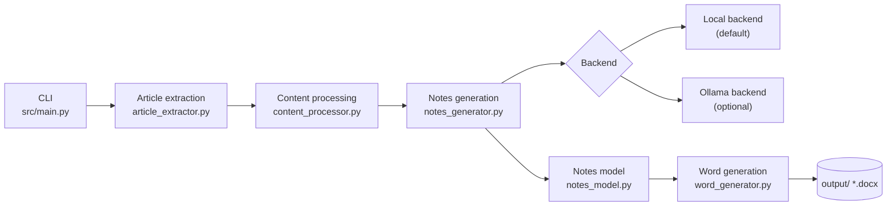

# NoteForge AI

Turn a public Substack article into a structured, professionally formatted **Word study-notes document**, with every sentence traceable to the article it came from.

> **Release status:** V1.0 controlled-release candidate. Validated on 2026-11-07 (see [Phase 9 validation report](docs/PHASE_9_FINAL_VALIDATION_REPORT.md) and [Release Notes](docs/RELEASE_NOTES_V1.0.md)). The program currently reports version `0.1.0` (see the [release checklist](docs/V1.0_RELEASE_CHECKLIST.md)).
> **Supported article source today: Substack.** PDF, Medium, YouTube and research-paper extraction are **not** supported.

## 1. The problem it solves

Long articles are hard to study from. Copying passages into notes by hand is slow, and AI summaries often mix the author's words with invented ones so you can no longer tell which is which. NoteForge AI produces study notes where **the origin of every item is visible**: the article's own words, text assembled by NoteForge's rules, or (optionally) text written by a language model, each clearly labelled and each pointing back to the paragraph it relies on.

## 2. Key capabilities

- Extracts a public Substack post (or a saved HTML page, or a plain-text file you supply) and tells you whether the extraction is **COMPLETE**, **PARTIAL** (paywall) or **NOT VERIFIED** (your own text).
- Builds **seven-chapter notes**: Article Overview, Detailed Concept Explanation, Important Technical Keywords, Real-Life Analogies and Applications, Key Takeaways, Quick Revision Notes, Questions and Answers (10 short-answer, 5 descriptive, 10 multiple-choice requested; fewer are produced when the article does not support that many distinct questions).
- Three detail levels: **Basic**, **Intermediate** (default), **Advanced**.
- Writes a formatted `.docx` (cover page, table of contents, headers and footers, tables, lists, code blocks, source references `[¶n]`, colour-coded origin labels).
- Checks its own output before saving (structure and provenance) and never overwrites an existing file without an explicit yes.
- **Free by default:** the Local backend needs no account, no API key and no AI model.
- Optional, experimental **Ollama** backend: a language model running on your own PC for richer explanations and analogies (always labelled, always needs human review).

## 3. Main workflow

```
Substack URL / HTML file / text file
        |
   extract  ->  process  ->  generate notes  ->  check  ->  write Word document
 (article_    (content_     (notes_generator    (validate +   (word_generator)
  extractor)   processor)    + chosen backend)   provenance)
```

The command-line program asks a few questions (source, detail level, include questions?), shows six progress steps, and prints the path of the finished document.

## 4. Architecture overview



Details: [docs/ARCHITECTURE.md](docs/ARCHITECTURE.md).

## 5. Supported input sources

| Menu option | Source | Notes |
|---|---|---|
| 1 | Public Substack post URL (`https://<name>.substack.com/p/<slug>` or a custom domain with a `/p/<slug>` path) | Read with a plain HTTP request: no login, no cookies, no paywall bypass |
| 2 | A saved HTML page (up to 10 MB) | Useful for an article you can read in your browser but NoteForge cannot fetch |
| 3 | A plain-text file (up to 10 MB) | You may add a title, author and date |

Completeness of options 2 and 3 cannot be verified, so those notes say "NOT VERIFIED". Localhost and private-network addresses are refused.

## 6. Local backend (default)

Rule-based and offline. It quotes and reorganises the article: definitions, key terms, takeaways, revision notes and questions are built from the article's own sentences. It does **not** write new explanations or analogies, so Chapter 4 explains that none were added. It takes a few seconds. See [docs/BACKEND_GUIDE.md](docs/BACKEND_GUIDE.md).

## 7. Ollama backend (optional, experimental)

Uses a model served by Ollama on your own computer (validated with `qwen3.5:4b`). Adds AI-written explanations, analogies and questions, each labelled "AI-generated". Notes can take several minutes, need free memory, and **must be reviewed by a person**: a built-in check compares wording with the article, but it does not verify facts. Only a loopback address (this PC) is accepted.

## 8. Installation (summary)

Requirements: Windows, Python (all testing used **Python 3.14.7**; other versions are untested), an internet connection for URL input and package installation. Full guide: [docs/INSTALLATION_GUIDE.md](docs/INSTALLATION_GUIDE.md).

## 9. Windows PowerShell setup

```powershell
cd "C:\path\to\NoteForge AI"
python -m venv .venv
.\.venv\Scripts\Activate.ps1
python -m pip install --upgrade pip
pip install -r requirements.txt
python src/main.py --version        # prints: NoteForge AI 0.1.0
```

If activation is blocked, see [Troubleshooting](docs/TROUBLESHOOTING.md).

## 10. CLI usage

```powershell
python src/main.py                              # interactive menu
python -m src.main                              # same, run from the project root
python src/main.py --output-dir "D:\MyNotes"    # choose where documents are saved
python src/main.py --version
```

Main menu:

```
  1. Generate notes from Substack URL.
  2. Generate notes from HTML file.
  3. Generate notes from text file.
  4. Select AI backend.
  5. View available models.
  6. View generated documents.
  7. Exit.
```

Type `b`, `back`, `cancel` or `q` at a prompt to return to the menu; press Ctrl+C to cancel the current action. Full walkthrough: [docs/USER_GUIDE.md](docs/USER_GUIDE.md).

## 11. Detail levels

| Level | What changes (from the implementation) |
|---|---|
| Basic | up to 8 key terms and 6 takeaways; the shortest notes |
| Intermediate (default) | up to 15 key terms and 10 takeaways |
| Advanced | up to 25 key terms and 16 takeaways; the longest notes |

Ollama notes take longer at higher levels. The program never reduces the level you chose.

## 12. Word document output

Saved in the project's `output/` folder (or `--output-dir`) as `<Article_Title>_Notes.docx`. If that name exists, you are asked whether to overwrite; answering No (the default) saves `<name>_2.docx`, `_3`, and so on. The program also keeps a log file, `noteforge.log`, in the same folder.

Colour and label legend inside the document: the article's own words (blue bar), text assembled by NoteForge's rules (grey), AI-generated text (purple box labelled "AI-GENERATED"). Partial articles carry a red "PARTIAL CONTENT" warning on the cover, in every page header and in every chapter.

Examples: [docs/examples/](docs/examples/README.md).

## 13. Example workflow

```text
Choose an option (1-7): 1
Article URL (for example https://name.substack.com/p/article-title): https://on.substack.com/p/what-you-get-when-you-start-a-substack
Detail (1-3 or name) [Intermediate]:
Include questions (10 short-answer, 5 descriptive, 10 multiple-choice)? [Y/n]:
Backend : Local - free, runs on this machine
[1/6] Reading and extracting the article ...
      Extracted : COMPLETE - 832 words in 51 blocks (trafilatura)
[2/6] Processing the content ...
[3/6] Writing the notes with Local ...
      Notes written in 0s: 1,377 words, 17 questions.
[4/6] Checking the notes (structure and provenance) ...
      OK: every quoted passage is from the article and the structure is valid.
[5/6] Creating the Word document ...
[6/6] Done.
Your document is ready:
  ...\output\What_you_get_when_you_start_a_substack_Notes.docx
```

(Transcript from the Phase 9 validation run on a public article; the output folder in that run was a temporary one.)

## 14. Configuration options

NoteForge AI has **no configuration file**. What exists:

- **Command-line options:** `--output-dir <folder>` and `--version`.
- **Menu choices per session:** backend (Local or Ollama), Ollama model, detail level, include questions. Defaults: Local, Intermediate, questions on.
- **Environment variables, read only for the Ollama backend** (set them in PowerShell with `$env:NAME = "value"`):

| Variable | Meaning | Default |
|---|---|---|
| `OLLAMA_BASE_URL` (or `OLLAMA_HOST`) | Ollama server address; must be this PC | `http://localhost:11434` |
| `OLLAMA_MODEL` | starting model (the menu can change it) | `qwen3.5:4b` |
| `OLLAMA_NUM_CTX` | context window, 2048-32768 | `8192` |
| `OLLAMA_TEMPERATURE` | 0 to 0.3 | `0.2` |
| `OLLAMA_THINK` | `true`, `false` or `default` | `false` |
| `OLLAMA_KEEP_ALIVE` | how long the model stays loaded, e.g. `10m` | `10m` |
| `OLLAMA_MAX_OUTPUT_TOKENS` | 64-4096 and under half of `OLLAMA_NUM_CTX` | `1500` |
| `OLLAMA_TIMEOUT` | seconds to wait for a reply | `900` |

> **About `.env` files:** the program does **not** load `.env` files automatically, and there is no settings file, so putting a variable in a `.env` file does **not** configure NoteForge AI. Only real environment variables take effect: set them in PowerShell before starting the program, for example `$env:OLLAMA_MODEL = "qwen3.5:4b"`. The file [`.env.example`](.env.example) in the project folder is a reference list of exactly the nine supported Ollama variables (the address can be given as `OLLAMA_BASE_URL` or its fallback `OLLAMA_HOST`, plus `OLLAMA_MODEL`, `OLLAMA_NUM_CTX`, `OLLAMA_TEMPERATURE`, `OLLAMA_THINK`, `OLLAMA_KEEP_ALIVE`, `OLLAMA_MAX_OUTPUT_TOKENS` and `OLLAMA_TIMEOUT`). The program never reads any `OPENAI_*` variable.

## 15. Troubleshooting

Common problems (activation blocked, invalid URL, paywall, Ollama not running, file in use) are covered with the exact messages in [docs/TROUBLESHOOTING.md](docs/TROUBLESHOOTING.md).

## 16. Known limitations

- Source: Substack only (plus user-supplied HTML or text). No PDF, Medium, YouTube or research-paper input.
- English-oriented heuristics (definitions, recommendations, keywords).
- Local notes are extractive: no new explanations or analogies. Question counts can be below the requested 10/5/10.
- Ollama notes are slow (minutes), memory-heavy (about 3.7 GB for the validated model), experimental and not guaranteed factually correct. The wording check is vocabulary-based.
- Each chapter starts on a new page; the last few lines of a list can occasionally spill onto an almost empty page. A table of contents of more than about 45 entries uses two pages.
- Not tested live: articles over about 2,000 words with real tables/code, non-English articles, a real keyboard Ctrl+C.
- Keyword noise can remain on marketing-style articles.

Full list: [Phase 9 report, section 11](docs/PHASE_9_FINAL_VALIDATION_REPORT.md).

## 17. Privacy and API cost

- **Cost:** none. No paid service can be reached from the command-line program, and it never reads `OPENAI_API_KEY` or any `OPENAI_*` variable. (An OpenAI backend module exists in the source for future use; it is not reachable from the menu and was never exercised against the real service.)
- **Network:** the only outgoing request is a plain `GET` of the article page you ask for (user agent `NoteForgeAI/0.1 (personal study-notes tool)`, no cookies, no login). HTML and text-file input need no network. Local generation is fully offline.
- **Ollama:** requests go only to your own PC (loopback); a non-local address is refused so article text cannot leave the machine.
- **Files:** documents and `noteforge.log` stay in your output folder. The log records timings, counts and file paths, not article text or secrets.
- **Paywalls** are never bypassed. Respect the article's licence: the notes quote the article, so they are meant for your personal study.

## 18. Testing

```powershell
pip install -r requirements-dev.txt
python -m pytest -o addopts="" -q
pip check
```

Validated results (2026-11-07): **1,712 tests passed** in both Bash and Windows PowerShell; `pip check` clean. These results do not guarantee defect-free operation.

## 19. Project layout

```
src/                 application code (main.py, article_extractor.py, content_processor.py,
                     notes_generator.py, notes_model.py, word_generator.py, backends/)
tests/               automated tests and saved HTML fixtures
docs/                guides, validation reports, examples
output/              generated documents (and noteforge.log)
requirements*.txt    dependencies (runtime, dev, optional openai)
```

## 20. Version and release status

Program version string: `0.1.0`. Release target: V1.0 controlled release, Windows, Local backend as the supported default. No Git tag has been created and nothing has been published. See [docs/RELEASE_NOTES_V1.0.md](docs/RELEASE_NOTES_V1.0.md) and [docs/V1.0_RELEASE_CHECKLIST.md](docs/V1.0_RELEASE_CHECKLIST.md).

### Documentation index

[Installation Guide](docs/INSTALLATION_GUIDE.md) · [User Guide](docs/USER_GUIDE.md) · [Backend Guide](docs/BACKEND_GUIDE.md) · [Troubleshooting](docs/TROUBLESHOOTING.md) · [Architecture](docs/ARCHITECTURE.md) · [Release Notes](docs/RELEASE_NOTES_V1.0.md) · [Release Checklist](docs/V1.0_RELEASE_CHECKLIST.md) · [Phase 10 report](docs/PHASE_10_RELEASE_PREPARATION_REPORT.md)
