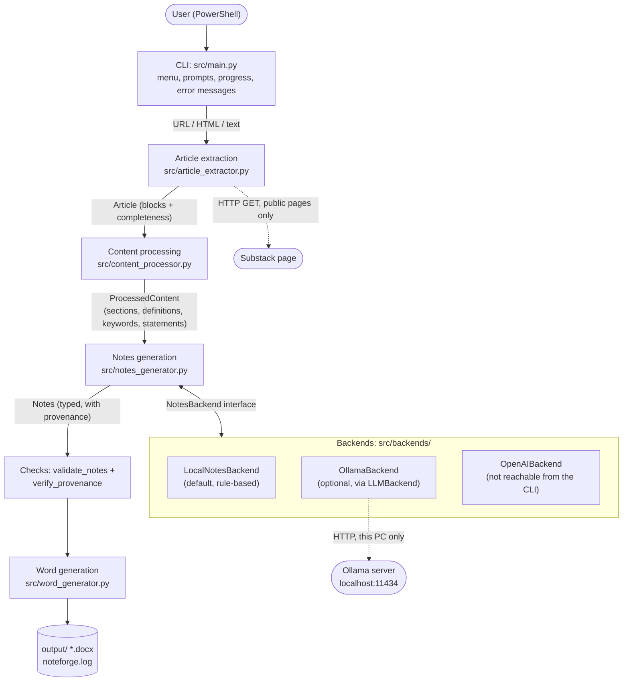
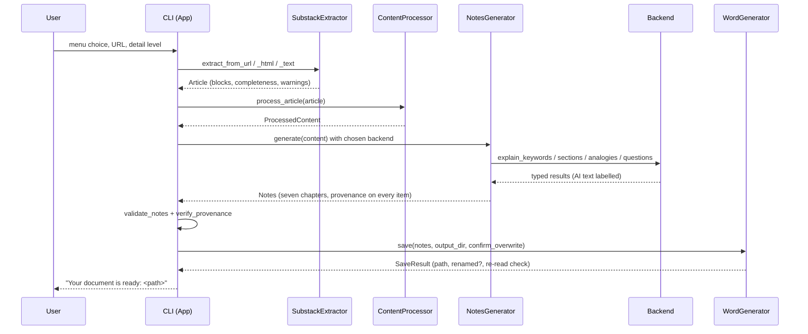

# NoteForge AI - Architecture

This document describes the architecture **as implemented** in the V1.0 candidate. It is documentation only; nothing here proposes a redesign. Back to the [README](../README.md).

## 1. Overview

NoteForge AI is a single-process Python command-line application. A linear pipeline turns a source into a typed `Notes` object, checks it, and renders it to a Word file. Each stage has one module and one data type handed to the next stage.

## 2. Components

| Component | File | Responsibility |
|---|---|---|
| CLI entry point | `src/main.py` | Interactive menu (`App`), prompts, progress `[1/6]..[6/6]`, user-facing error text (`describe_error`), session settings, logging to `noteforge.log`, `--output-dir` and `--version`. Orchestrates only; it does no extraction or writing itself |
| Article extraction | `src/article_extractor.py` | `SubstackExtractor`: URL validation (https, public hosts only), `HttpFetcher` (plain GET, size and redirect limits), Trafilatura as primary extractor with readability-lxml as fallback, metadata (title, author, date, JSON-LD and og:title), paywall and login detection, `Completeness` (COMPLETE / PARTIAL / UNVERIFIED). Produces a source-agnostic `Article` made of typed `Block`s (heading, paragraph, list with nesting depth, code, table, quote). `ArticleExtractor` is an abstract interface; Substack is the only implementation |
| Content processing | `src/content_processor.py` | Cleans blocks, drops boilerplate and safe duplicates (every removal is recorded with a reason), builds the heading tree, extracts definitions, keywords and key statements by transparent rules. Nothing is invented; every item carries indices into `article.blocks` |
| Notes model | `src/notes_model.py` | Typed models shared by all later stages: `Notes`, `Chapter`, `NoteSection`, `NoteItem`, `Question`, `DetailLevel`, `NoteProvenance`, `BackendInfo`, and `validate_question` |
| Notes generation | `src/notes_generator.py` | Owns the seven-chapter structure and everything that can be quoted verbatim; asks the chosen backend only for generative parts; enforces no-repetition rules, partial-content banners, and offers `validate_notes` / `verify_provenance` |
| Backend abstraction | `src/backends/base.py`, `__init__.py` | `NotesBackend` interface (keyword explanations, section explanations, analogies, questions), request/response types, backend errors, and `resolve_backend` (Local by default; an unavailable Ollama falls back to Local with the reason recorded) |
| Local backend | `src/backends/local.py`, `local_questions.py` | Deterministic, offline. Quotes and reorganises the article; builds questions from its definitions, statements, tables and lists with fact and per-block budgets. Writes no new prose |
| LLM base and safeguards | `src/backends/llm.py` | Shared by model-based backends: prompts, JSON parsing, grounding checks (numbers, citations, "studies show", versions, quotations), sentence-level support assessment, analogy review markers, question source location and diversity limits |
| Ollama backend | `src/backends/ollama.py` | `OllamaSettings` (from `OLLAMA_*` variables), availability probe, serialised requests with a size check, timeouts, loopback-only enforcement |
| OpenAI backend | `src/backends/openai_backend.py` | A module requiring explicit enablement, a confirmation handler and a model; **not reachable from the CLI** and not exercised against the real service |
| Word generation | `src/word_generator.py` | Renders `Notes` to `.docx` with python-docx: styles per provenance, cover, TOC field, headers/footers, tables, lists, code, references; `verify_document` re-reads the file to prove nothing was dropped; safe file naming and saving |

`src/extractors/` is an empty package; it is not used.

## 3. Data flow and main types

`Article` -> `ProcessedContent` -> `Notes` -> `.docx`. Each type is a plain dataclass; stages do not share hidden state.

## 4. Backend abstraction

The generator never sees prompts or HTTP, and a backend never sees chapter layout. A backend implements four methods; the Local backend returns the article's own sentences or nothing, and model backends return text marked `AI_GENERATED`. `resolve_backend("local" | "ollama" | "openai")` builds the backend; the default is Local and environment variables never change it. The CLI offers only Local and Ollama and reads only the `OLLAMA_*` variables. If Ollama is unavailable the CLI asks before using Local; if the server dies mid-run, the remaining parts fall back to Local without retrying and the notes record why.

## 5. Provenance and source references

Every item in the notes carries a `NoteProvenance`:

| Value | Meaning | Word style |
|---|---|---|
| `ORIGINAL` | Verbatim from the article (checked to really occur in it) | blue bar |
| `DERIVED` | Written by NoteForge's deterministic rules (labels, structure, questions assembled from article sentences) | grey bar |
| `AI_GENERATED` | Written by a language model; never presented as the article's words | purple box, "AI-GENERATED" label |

Items and questions carry `source_indices`, indices into the article's blocks, printed as 1-based `[¶n]` references (AI items: "based on ¶n"). `verify_provenance` checks that ORIGINAL text occurs in the article and `validate_notes` checks structure; the CLI runs both before writing. Partial and unverified articles are flagged in a banner and in every chapter. Model output is additionally filtered by `llm.py` (section 2) and marked "Review needed" where it is only partly supported.

## 6. Output management

- Default folder: `output/` in the project (`DEFAULT_OUTPUT_DIR`), or `--output-dir`.
- File name: `<Article_Title>_Notes.docx` via `safe_filename` (Windows-safe, Unicode letters kept, 80-character title limit, reserved names avoided).
- Existing files are never overwritten without confirmation (default No); otherwise the file is created exclusively under `_2`, `_3`, ... A write outside the output folder is refused.
- After saving, `verify_document` re-reads the file against the notes and reports anything missing.
- `noteforge.log` is appended in the output folder for each run.
- If the Word step fails, the CLI offers a JSON backup of the notes (`<Title>_Notes.json`, never overwriting).

## 7. Error handling

- A typed exception hierarchy per stage: extraction (`InvalidSourceError`, `FetchError`, `PaywallError`, `ArticleInaccessibleError`, `NoContentError`), processing (`ProcessingError`), backends (`BackendError` and subclasses), notes (`NotesGenerationError`), Word (`WordGenerationError`).
- `describe_error` in `main.py` turns each into plain language with a next step. The menu loop catches everything, so a bug or failure returns to the menu instead of ending the session.
- Optional analysis steps in the processor are guarded: a failing step is recorded as a warning and the structure is still delivered. A failing backend method degrades only that part of the notes.
- Ctrl+C is handled at the menu (exit code 130) and inside actions (cancel, no document). Closed input ends cleanly. A leading UTF-8 byte-order mark in input is removed.
- Safety rules are enforced in code: no paywall bypass, no cookies or login, private hosts refused, Ollama on this machine only, no paid call without explicit enablement and confirmation.

## 8. Tests

`tests/` holds one test module per stage plus defect-regression modules for Phases 8-9 and saved HTML fixtures in `tests/fixtures/`. All tests run offline with scripted model replies; none contacts Ollama or a paid service. 1,712 tests passed in the 2026-11-07 validation.

## 9. Extension points (not implemented)

`ArticleExtractor` is the interface a future extractor would implement, and `NotesBackend` the interface for another backend. No other source format exists in V1.0.
